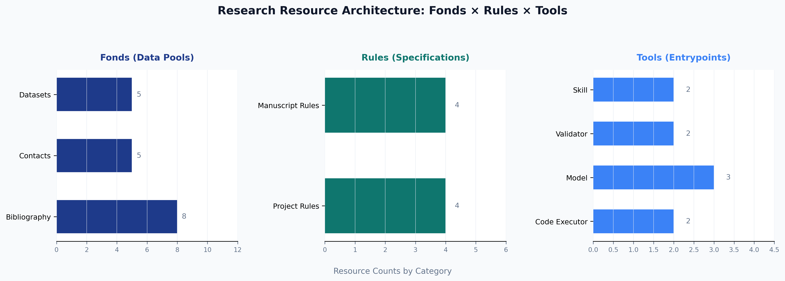

# Pools, Rules, and Tools

This Python exemplar discovers read-only Template resource pools, checks rules
against the current project, and validates declared tool entrypoints. It renders
a paper with integration counts, evidence figures, and a bibliography.

- [Documentation](docs/README.md)
- [Setup, usage, and verification](docs/quickstart.md)
- [Manuscript](docs/manuscript/README.md)
- [Publication configuration](docs/publishing.md)

## Publication status

<!-- PUBLISHING-STATUS:START (generated by infrastructure.publishing.status_report) -->
**Pools, Rules, and Tools: A Template-Integrated Resource Architecture** · v1.0.0 · Daniel Ari Friedman

Concept DOI: [10.5281/zenodo.21298888](https://doi.org/10.5281/zenodo.21298888) | Version DOI: [10.5281/zenodo.21298889](https://zenodo.org/records/21298889) | Repository: [docxology/template_pools_rules_tools](https://github.com/docxology/template_pools_rules_tools)

Publishing surface — 20 platforms, 2 published:

| Platform | Tier | Status | Reference | Credentials |
| --- | --- | --- | --- | --- |
| zenodo | first-class | ✅ published | [10.5281/zenodo.21298888](https://doi.org/10.5281/zenodo.21298888) | `ZENODO_API_TOKEN` |
| github | first-class | ✅ published | [docxology/template_pools_rules_tools](https://github.com/docxology/template_pools_rules_tools) | `GITHUB_TOKEN` |
| arxiv | first-class | ⚪ available | — | — |
| pypi | first-class | ⚪ available | — | `PYPI_TOKEN`, `TESTPYPI_TOKEN` |
| ipfs_pinata | first-class | ⚪ available | — | `PINATA_JWT` |
| ipfs_web3storage | first-class | ⚪ available | — | `WEB3_STORAGE_TOKEN` |
| software_heritage | first-class | ⚪ available | — | — |
| github_pages | first-class | ⚪ available | [docxology/template_pools_rules_tools](https://github.com/docxology/template_pools_rules_tools) | `GITHUB_TOKEN` |
| cloudflare_pages | first-class | ⚪ available | — | `CLOUDFLARE_API_TOKEN` |
| netlify | first-class | ⚪ available | — | `NETLIFY_AUTH_TOKEN` |
| huggingface_hub | first-class | ⚪ available | — | `HUGGINGFACE_TOKEN`, `HF_TOKEN` |
| osf | first-class | ⚪ available | — | `OSF_TOKEN` |
| amazon_kdp | documented | 🟡 planned | — | `AMAZON_KDP_EMAIL`, `AMAZON_KDP_PASSWORD` |
| google_play_books | documented | 🟡 planned | — | `GOOGLE_PLAY_BOOKS_SERVICE_ACCOUNT_JSON` |
| gumroad | documented | 🟡 planned | — | `GUMROAD_ACCESS_TOKEN` |
| leanpub | documented | 🟡 planned | — | `LEANPUB_API_KEY` |
| lulu | documented | 🟡 planned | — | `LULU_CLIENT_KEY`, `LULU_CLIENT_SECRET` |
| draft2digital | documented | 🟡 planned | — | `DRAFT2DIGITAL_API_TOKEN` |
| stripe | documented | 🟡 planned | — | `STRIPE_SECRET_KEY`, `STRIPE_PUBLISHABLE_KEY` |
| ingramspark | documented | 🟡 planned | — | `INGRAMSPARK_CLIENT_ID`, `INGRAMSPARK_CLIENT_SECRET` |

_Status legend: ✅ published (durable identifier recorded in `config.yaml`) · 🔵 reserved (identifier reserved but not yet registered by final publication) · ⚪ available (adapter implemented and locally verifiable) · 🟡 planned. This block is generated — see the publication configuration guide to regenerate it._
<!-- PUBLISHING-STATUS:END -->
